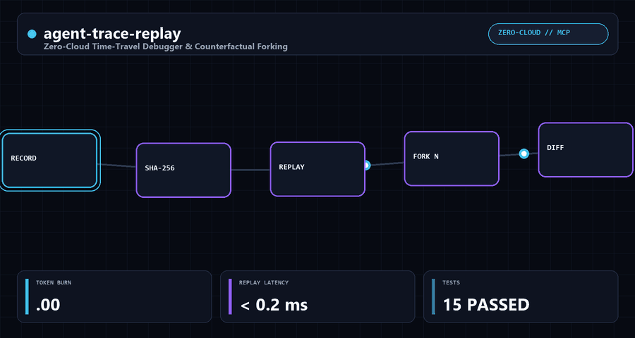

<div align="center">


<br/>

[](#-quickstart)
[](pyproject.toml)
[](https://modelcontextprotocol.io/)
[](#-architectural-benchmark-cloud-observability-vs-agent-trace-replay)
[](#-architecture)
[](LICENSE)
[](https://benni-os.net)

<br/>

> **Zero-Cloud Time-Travel Debugger, Deterministic Trajectory Replay & Counterfactual Forking for AI Agents & MCP.**  
> Zero external LLM token burn. Zero telemetry leaks. Cryptographic SHA-256 event chains. Branch from any step `N` and diff trajectories in `< 1ms`.

<br/>



</div>

---

## ⚡ The Problem: Why Debugging AI Agents in Production Breaks

When an autonomous agent fails at step 14 of a 20-step MCP workflow, re-running the entire trajectory from scratch is slow, expensive, and non-deterministic:

1. **Cloud Telemetry Lock-In & Data Exfiltration:** Platforms like `LangSmith`, `Arize Phoenix`, and `AgentOps` ship sensitive prompts, tool arguments, and proprietary codebases to external cloud SaaS or heavy OpenTelemetry collectors.
2. **Repeated LLM Token Burn During Debugging:** Re-running a multi-step agent loop just to reproduce a bug at step 14 burns fresh GPT-4 / Claude tokens on steps 1–13 every single time.
3. **No Counterfactual Branching ("What If Step N Returned X?"):** Existing observability tools are read-only trace viewers—you cannot fork from step `N`, inject a modified tool output or prompt variant, and measure the exact structural, token, and latency delta.
4. **No Cryptographic Tamper Proofing:** Plain JSON logs can be silently mutated without breaking integrity checks, making post-mortem audits unreliable.

---

## 🏆 Architectural Benchmark: Cloud Observability vs `agent-trace-replay`

| Feature / Metric | `LangSmith` | `Arize Phoenix` | `AgentOps` | `agent-trace-replay` (Benni OS) |
| :--- | :---: | :---: | :---: | :---: |
| **Telemetry Privacy** | ❌ Cloud SaaS | ⚠️ Local / Cloud OTEL Server | ❌ Cloud SaaS | **✅ 100% Zero-Cloud (JSONL / SQLite)** |
| **Replay Token Cost** | Paid re-execution | Read-only viewer | Read-only viewer | **✅ $0.00 (Offline Deterministic Stubs)** |
| **Counterfactual Forking** | ⚠️ Manual playground | ❌ No | ❌ No | **✅ Branch at Step N + Structural Diff** |
| **Integrity Verification** | ❌ Mutable logs | ❌ Mutable spans | ❌ Mutable events | **✅ SHA-256 Chained Event Ledger** |
| **Runtime Dependencies** | Heavy SDK + API key | Heavy OTEL + SQL/Server | Heavy SDK + API key | **✅ Pure Python 3.10+ (Zero Dependencies)** |
| **Native MCP Server** | ❌ No | ❌ No | ❌ No | **✅ Built-in JSON-RPC 2.0 stdio** |

---

## 🏗️ Architecture

```text
  AI Agents / MCP Clients / CI Replay Gates
         │
         ├──► CLI   trace-replay record-demo | inspect | replay | fork | diff | doctor | matrix
         └──► STDIO JSON-RPC 2.0 (trace-replay mcp)
                       │
                       ▼
  ┌─────────────────────────────────────────────────────────────────────┐
  │                       agent-trace-replay (ATR)                      │
  │                                                                     │
  │  ┌───────────────────┐  ┌───────────────────┐  ┌─────────────────┐  │
  │  │ TraceRecorder     │  │  TraceReplayer    │  │ Counterfactual  │  │
  │  │ • Seed & Clock    │─►│  • $0.00 Offline  │─►│ Forker          │  │
  │  │ • SHA-256 Chain   │  │  • Drift Detector │  │ • Branch Step N │  │
  │  │ • State Snapshots │  │  • Time-Travel    │  │ • TrajectoryDiff│  │
  │  └───────────────────┘  └───────────────────┘  └─────────────────┘  │
  │                                                                     │
  │  ┌───────────────────┐  ┌───────────────────┐  ┌─────────────────┐  │
  │  │ TraceStore        │  │  Serve & MCP      │  │  Tools & Doctor │  │
  │  │ • Local JSONL     │  │  • JSON-RPC 2.0   │  │  • Self-Test    │  │
  │  │ • Local SQLite3   │  │  • Telemetry P99  │  │  • Bench Matrix │  │
  │  └───────────────────┘  └───────────────────┘  └─────────────────┘  │
  └─────────────────────────────────────────────────────────────────────┘
         │                                         │
         ▼                                         ▼
   Local Zero-Cloud Ledger                 Deterministic Replay & Diff
   (.jsonl / .sqlite + SHA-256)            ($0.00 LLM Burn / < 1ms Diff)
```

See [docs/ARCHITECTURE.md](docs/ARCHITECTURE.md) for the full layer specification.

---

## 🚀 Quickstart

### 1. Installation

```bash
pip install -e .
```

### 2. Record, Time-Travel Inspect, Replay & Fork via CLI

```bash
# 1. Record a deterministic 7-step AI agent + MCP demo trajectory
trace-replay record-demo --out .traces/demo.jsonl

# 2. Time-travel inspect step 2 (verify SHA-256 hash & cumulative state)
trace-replay inspect .traces/demo.jsonl --seq 2

# 3. Replay offline with $0.00 token burn and drift detection
trace-replay replay .traces/demo.jsonl

# 4. Counterfactual fork from step 5 with a simulated test failure
trace-replay fork .traces/demo.jsonl --seq 5 \
  --output-override '{"passed": 11, "failed": 1, "status": "fail"}' \
  --out .traces/demo.fork5.jsonl

# 5. Diff base vs counterfactual fork
trace-replay diff .traces/demo.jsonl .traces/demo.fork5.jsonl
```

### 3. Run Verification Tests

```bash
pytest -v
```

---

## 🏗️ Model Context Protocol (MCP) Integration

`agent-trace-replay` ships with a native JSON-RPC 2.0 stdio MCP server for **Claude Desktop, Claude Code, Cursor, Windsurf, and Cline**.

Add to your `claude_desktop_config.json` or `.cursor/mcp.json`:

```json
{
  "mcpServers": {
    "agent-trace-replay": {
      "command": "trace-replay",
      "args": ["mcp"]
    }
  }
}
```

Exposed MCP tools:
- `trace_inspect` — Time-travel inspect a trajectory or jump to step `seq` with SHA-256 verification.
- `trace_replay` — Deterministic offline replay with `$0.00` token burn and drift detection.
- `trace_fork` — Counterfactual branch from step `fork_seq` with modified tool output or prompt variant.
- `trace_diff` — Structural, token, and latency diff between base and forked trajectories.

---

## 📁 Project Structure

```text
agent-trace-replay/
├── src/
│   └── agent_trace_replay/
│       ├── __init__.py                   # Backwards-compatible public exports
│       ├── cli.py                        # CLI entrypoint (record-demo, inspect, replay, fork, diff, mcp, doctor, matrix)
│       ├── core/
│       │   ├── __init__.py               # Core package exports
│       │   ├── models.py                 # TraceEvent, EventType, GENESIS_HASH & SHA-256 chain verifier
│       │   ├── recorder.py               # TraceRecorder & TraceStore (JSONL / SQLite3)
│       │   ├── replayer.py               # TraceReplayer ($0.00 offline replay, drift & time-travel)
│       │   └── forker.py                 # CounterfactualForker & TrajectoryDiff engine
│       ├── serve/
│       │   ├── __init__.py               # Serve package exports
│       │   ├── mcp_server.py             # Zero-dependency JSON-RPC 2.0 stdio MCP server
│       │   ├── telemetry.py              # Replay/fork P50/P90/P99 latency & token-savings telemetry
│       │   └── health_monitor.py         # Disk headroom, SQLite3 & SHA-256 chain health monitor
│       └── tools/
│           ├── __init__.py               # Tools package exports
│           ├── doctor.py                 # Runtime diagnostics & end-to-end pipeline self-test
│           └── bench_matrix.py           # Multi-scale trajectory replay & fork benchmark matrix
├── examples/
│   ├── quickstart_time_travel.py         # Record, time-travel inspect & offline replay quickstart
│   └── counterfactual_fork_demo.py       # Branch at step N & compute TrajectoryDiff
├── scripts/
│   ├── benchmark_replay_throughput.py    # 10–500 step replay & fork throughput benchmark
│   └── gate_trace_integrity.py           # Release integrity gate runner
├── docs/
│   └── ARCHITECTURE.md                   # Layer-by-layer architectural specification
└── tests/
    ├── test_cli_and_mcp.py               # CLI & JSON-RPC 2.0 MCP server tests
    ├── test_forker.py                    # Counterfactual forking & TrajectoryDiff tests
    ├── test_recorder.py                  # SHA-256 chain, JSONL & SQLite persistence tests
    ├── test_replayer.py                  # Offline replay, drift detection & time-travel tests
    └── test_serve_and_tools.py           # Telemetry, health monitor, doctor & bench matrix tests
```

---

## 🏛️ Commercial & Sovereign Architecture

Need autonomous multi-agent swarm orchestration, private datacenter infrastructure, or enterprise governance?

- **Official Website:** [https://benni-os.net](https://benni-os.net)
- **Operator Mode Playbook:** [https://benni-os.net/blog/academy.html](https://benni-os.net/blog/academy.html)
- **GitHub Organization:** [https://github.com/Benni-OS](https://github.com/Benni-OS)
- **Maintainer:** [Benni Alencar](https://github.com/BenniAlencar)

---

## 📄 License & Provenance

- **License:** [MIT License](LICENSE)
- **Author:** Benni Alencar (`bennialencar@benni-os.net`)
- **Architecture:** Benni Master OS v9.4 Tier-0 Governance Standard

<div align="center">


**agent-trace-replay** — *Zero-Cloud Time-Travel Debugger & Counterfactual Replay for AI Agents* • [benni-os.net](https://benni-os.net) • `MIT License`

</div>
